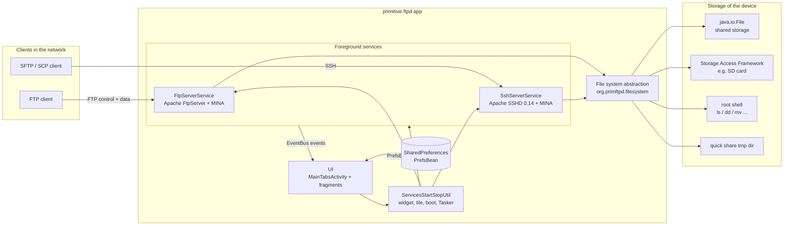

# Architecture of primitive ftpd

primitive ftpd is an Android app which turns the device into an **FTP and SFTP
server**, so files can be exchanged with any FTP/SFTP client in the local
network. It needs no root: root access is one optional way to reach files.

| File | Content |
|------|---------|
| [components.md](components.md) | Modules, packages, most important classes, libraries |
| [runtime-flows.md](runtime-flows.md) | Start/stop of servers, threads, how a transfer runs, timers, events |
| [storage.md](storage.md) | File system abstraction and the storage types (plain, root, SAF, read-only SAF, virtual, quick share) |
| [android-integration.md](android-integration.md) | Manifest components, permissions, use without root, remote control |

State described: branch `fix/review-large-files-hardening`, 2026-11-21.

## Big picture

The app has three layers:

1. **Control and UI.** Activities, fragments, widget, quick settings tile,
   boot receiver and remote control plugins. They never talk to the servers
   directly: they read the preferences into an immutable `PrefsBean` and
   start or stop the two services through `ServicesStartStopUtil`.
2. **Server services.** Two Android foreground services, one per protocol.
   Each wraps a server library (Apache FtpServer, Apache SSHD) which does
   the protocol work and calls back into the app for authentication and for
   file access.
3. **File system abstraction.** One set of classes per storage type, each in
   an FTP and an SFTP flavour, which map the file interfaces of the two
   server libraries to the storage of the device.

## Repository layout

| Path | What it is |
|------|------------|
| `primitiveFTPd/` | The Android app (`org.primftpd`). Sources in `src/`, resources in `res/`, manifest in `AndroidManifest.xml`. |
| `pftpd-pojo-lib/` | Plain Java library without Android dependencies: parser for `authorized_keys` (`KeyParser`) and for output of `ls -l` (`LsOutputParser`). Has the unit tests of the project. |
| `sshd-core-0.14.0/` | Apache MINA SSHD 0.14.0, vendored as source with local patches (e.g. SFTP subsystem, SCP). |
| `tests/tests.py` | Script for manual end to end tests against a device with real FTP / SFTP clients. |
| `fastlane/` | Store metadata and screenshots. |
| `gradle/libs.versions.toml` | All versions (SDK levels, plugins, libraries). |
| `architecture/` | This documentation. |
| `code-review/` | Findings of the code reviews, `code-review/improve/` lists what has been changed. |

## Build

* Gradle with the Android Gradle Plugin 9.0, JDK 21 tool chain, Java 11
  language level, core library desugaring.
* `minSdk` 26 (Android 8.0), `targetSdk` / `compileSdk` 36.
* `./gradlew build` builds everything and runs the unit tests of
  `pftpd-pojo-lib`. CI is `.github/workflows/gradle.yml`.
* No minification (`minifyEnabled = false`), class and field names are kept.

## Design decisions worth knowing

* **The preferences are frozen when a server starts.** The services get a
  serialized `PrefsBean` in the start intent. Changing a preference has no
  effect on a running server, it must be restarted.
* **Two services, shared process state.** FTP and SFTP run independently but
  share a wake lock, the root shell and the notification. This shared state
  is reference counted in `ServerServiceHandler`.
* **Old SSH library.** `sshd-core` 0.14 is vendored as source, the versions
  of FtpServer and MINA are pinned to what it works with (see comment in
  `gradle/libs.versions.toml`). It is the reason for several limitations
  (see `code-review/security.md`).
* **Streams, not random access.** Both server libraries ask the file system
  for an input or output stream at an offset. Everything else (resume,
  append, SFTP reads at arbitrary positions) is built on that.
* **Loose coupling by events.** Services and UI communicate through
  greenrobot EventBus, there is no bound service interface.
