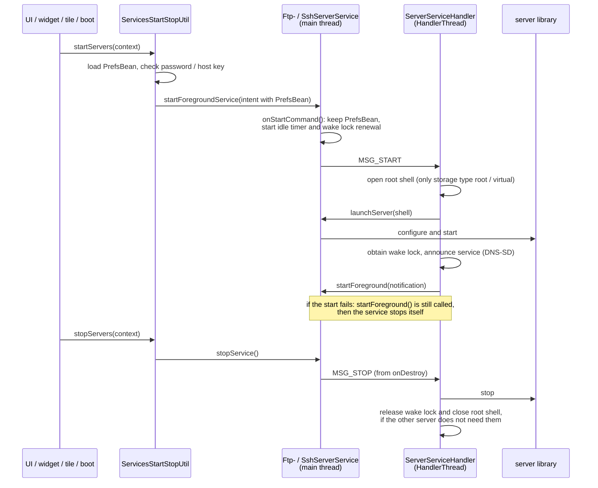
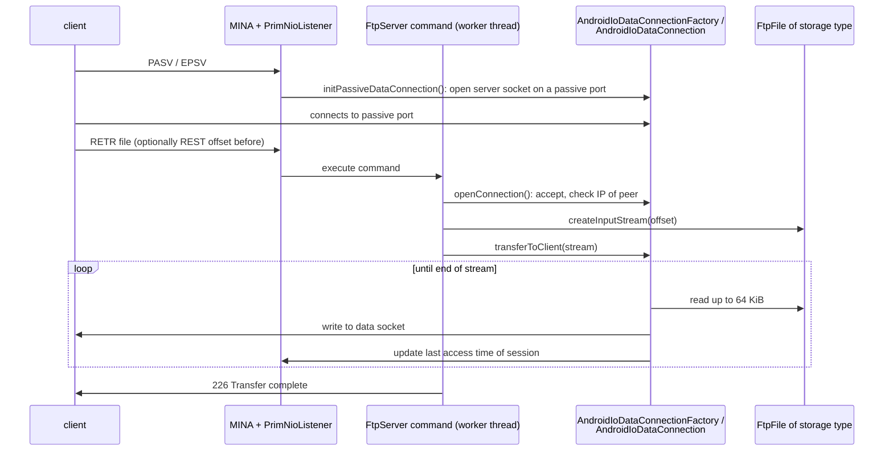
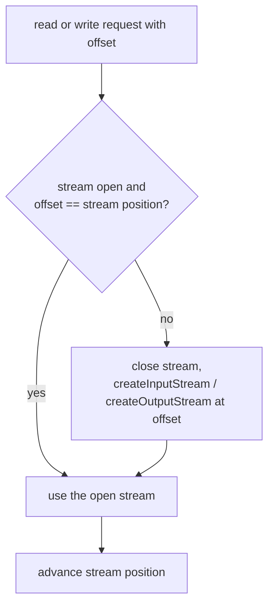

# Runtime flows

## Starting and stopping the servers

Every way to start the servers ends in `ServicesStartStopUtil.startServers()`:
the start button of the main screen, the widget, the notification action, the
quick settings tile, the boot receiver, the shortcuts, Tasker / PowerToggles
and quick share.

Rules which are easy to get wrong:

* A service started with `startForegroundService()` **must** call
  `startForeground()`, also when the server could not be started or was
  running already. Otherwise Android crashes the whole app, including the
  other server.
* Wake lock, root shell and the "running" state of widget and notification
  are shared by both services. `ServerServiceHandler` counts users, a server
  which stops (or fails to start) must not take them away from the other one.
* `PrefsBean` is copied into the service at start. A running server never
  sees changed preferences.

## Threads

| Thread | Work |
|--------|------|
| Main thread | UI, `onStartCommand()` / `onDestroy()` of services, timers (`Handler`), event bus subscribers with `ThreadMode.MAIN` |
| `ServiceStartArguments` (one `HandlerThread` per service) | Start and stop of a server |
| MINA acceptor and I/O processors | Sockets of FTP control connections and of SSH |
| FtpServer worker pool (ordered per session) | FTP commands **including the data transfer**: one command of a session runs at a time, a transfer blocks its session until it is done |
| `sshd-SftpSubsystem-thread` (one per SFTP channel) | SFTP requests of that channel, one after the other |
| libsuperuser threads | Root shell: commands are queued, callers wait with `waitForIdle()` |
| `AsyncTask` thread | Copying shared files (`AbstractReceiveShareActivity`) |
| `DownloadsService` `HandlerThread` | Download of a URL |

## FTP transfer

* Uploads (`STOR`, `APPE`) are the same with `createOutputStream(offset)`
  and `transferFromClient()`. `APPE` and resumed uploads pass the current
  size as offset.
* The control connection has no traffic while data is transferred. MINA
  therefore reports it as idle. `PrimNioListener` ignores such an idle event
  when the session has been used within the idle time (the transfer loop
  updates the access time), otherwise long transfers would end in a closed
  session.
* Data connections are only accepted from the address of the control
  connection (passive) and only opened to it (active). Waiting for a passive
  connection is limited to the idle time, 2 minutes if none is configured.
* ASCII mode is not implemented, everything is transferred binary.

## SFTP transfer

SFTP has no "transfer" command. A client opens a file, sends many read or
write requests with an offset and closes the file. `SftpSubsystem.FileHandle`
maps this to streams:

* Sequential transfers (all usual clients) use a single stream for the whole
  file. Random access works but re-opens the stream each time.
* Reads fill the requested length completely, otherwise clients would ask
  for the rest and the stream would be re-opened for every request.
* Closing a handle closes the stream and reports errors of that to the
  client (buffered data is written at this point).
* Attributes sent while a file is written (`put -p` sends the modification
  time before closing) are applied again after the stream has been closed.
* SSH keys are exchanged again after 1 GB or 1 hour (`ServerSession`), a
  large transfer therefore passes several re-keyings.

## What keeps a long transfer alive

| Mechanism | Default | During a transfer |
|-----------|---------|-------------------|
| Idle timeout of sessions (preference, seconds) | 0 = none | FTP: idle events are ignored while data flows. SSH: every request resets the timer. |
| Stop server when idle (preference, minutes) | 30 | `AbstractServerService` checks the time stamp of the last transferred data of both protocols and postpones the stop. |
| Wake lock (preference) | 60 minutes time out | Renewed every 5 minutes while data flows. |

Both servers record the time of the last transferred block in a static field
(`AndroidIoDataConnection.getLastTransferTimestamp()`,
`SftpSubsystem.getLastTransferTimestamp()`).

## Events

| Event | Posted by | Consumed by |
|-------|-----------|-------------|
| `ClientActionEvent` (list, upload, download, delete, error ...) | file system classes through `PftpdService.postClientAction()` | `ClientActionFragment` (log of client actions), `AbstractServerService` (restarts the idle stop timer) |
| `ServerStateChangedEvent` | services on start and destroy | main screen, quick settings tile |
| `ServerInfoRequestEvent` / `ServerInfoResponseEvent` | UI asks a running service, e.g. for the number of quick share files | services / UI |

## Sharing into the app

Other apps can share data with two activities:

* **Quick share** (`ReceiveQuickShareActivity`): copies the shared files to
  a temporary directory inside the app's external files dir and starts the
  servers in quick share mode, where only this directory is visible and
  read-only. The directory is deleted when the server stops.
* **Save as** (`ReceiveSaveAsActivity`): lets the user pick a target
  directory (plain or SAF) and copies the shared data there. A shared URL
  can be downloaded instead (`DownloadsService`, into the download folder).

Copying runs in a background task with a wake lock, file names coming from
other apps are sanitised (`FilenameUnique`), URIs pointing to private data of
the app are refused.
