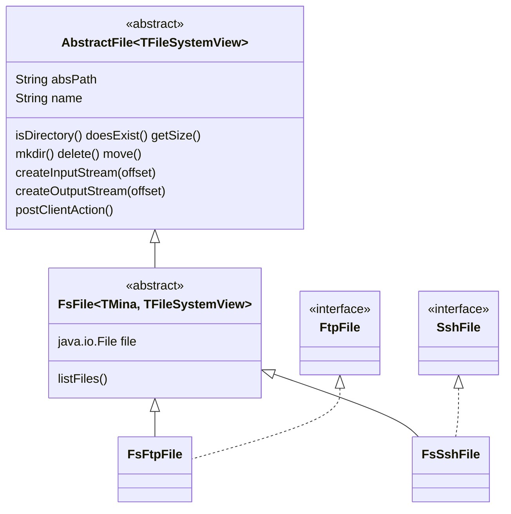

# File system abstraction and storage types

## The problem it solves

Apache FtpServer and Apache SSHD each define their own file interfaces:

| | FTP | SFTP / SCP |
|---|-----|-----------|
| File | `org.apache.ftpserver.ftplet.FtpFile` | `org.apache.sshd.common.file.SshFile` |
| View of a session | `org.apache.ftpserver.ftplet.FileSystemView` | `org.apache.sshd.common.file.FileSystemView` |

The app supports several kinds of storage, each must be available for both
protocols. To avoid writing everything twice the logic of a storage type
lives in a generic base class, two thin subclasses adapt it to the protocol.



The same pattern exists for every storage type:

| Storage type | Base classes | FTP | SFTP |
|--------------|--------------|-----|------|
| Plain | `FsFile`, `FsFileSystemView` | `FsFtpFile`, `FsFtpFileSystemView` | `FsSshFile`, `FsSshFileSystemView` |
| Root | `RootFile`, `RootFileSystemView` | `RootFtp...` | `RootSsh...` |
| SAF | `SafFile`, `SafFileSystemView` | `SafFtp...` | `SafSsh...` |
| Read-only SAF | `RoSafFile`, `RoSafFileSystemView` | `RoSafFtp...` | `RoSafSsh...` |
| Virtual | `VirtualFile`, `VirtualFileSystemView` | `VirtualFtp...` | `VirtualSsh...` |
| Quick share | `QuickShareFile`, `QuickShareFileSystemView` | `QuickShareFtp...` | `QuickShareSsh...` |

A `...FileSystemView` is created per client session by the factory lambdas in
`FtpServerService` / `SshServerService`, depending on
`PrefsBean.getStorageType()` (or quick share mode). The FTP views keep a
working directory, the SFTP views resolve relative paths against the home
directory.

Common helpers: `Utils` (path handling, `skipFully()` / `openAtOffset()`),
`FtpUtils` / `SshUtils` (client IP, SFTP attributes), `MediaScannerClient`
(tells Android's media store about changed files), `StorageManagerUtil`
(volume paths, time stamp resolution of FAT / exFAT cards),
`TracingBufferedOutputStream`.

## Storage types

| Type | How files are accessed | Needs | Write | Notes |
|------|------------------------|-------|-------|-------|
| **Plain** (default) | `java.io.File` | "All files access" on Android 11+, storage permission up to Android 10. **No root.** | yes | Fastest and most complete. Start directory is a preference. Use SAF if an SD card can not be written this way. |
| **SAF** | `DocumentFile` / `DocumentsContract` on a directory tree the user picked | Tree permission granted in the system picker. **No root.** | yes | For external SD cards. Slower. Move only within a directory. |
| **Read-only SAF** | `DocumentsContract` queries only | as SAF | no | Much faster listings than SAF. |
| **Root** | Commands in a root shell: `ls -la` to list, `dd` to read and write (or copy to a tmp dir first), `mv`, `rm -rf`, `mkdir`, `touch` | **Rooted device** | yes | Reaches everything. Without root nothing can be accessed, the server refuses to start with this type. |
| **Virtual** | Combines the four above under `/fs`, `/superuser`, `/saf`, `/rosaf` | what the used branch needs | per branch | `/superuser` is empty on devices without root, the other branches work. |
| **Quick share** | Temporary directory with the shared files | nothing | no | Not selectable, active when the server was started by sharing files. |

## Streams and offsets

Everything a client transfers goes through two methods:

```java
InputStream  createInputStream(long offset)
OutputStream createOutputStream(long offset)
```

| Type | Read at offset | Write at offset 0 | Write at end (append / resume) | Write elsewhere |
|------|----------------|-------------------|--------------------------------|-----------------|
| Plain | seek (`FileInputStream.skip`) | truncates | `FileOutputStream` in append mode | `RandomAccessFile` |
| SAF | seek on the file descriptor of the provider | mode `wt` (truncate) | mode `wa` | error |
| Read-only SAF | seek | not writable | not writable | not writable |
| Root, `dd` | reads and discards up to offset (pipe) | `dd of=` | error | error |
| Root, copy mode | copy to tmp dir, then seek | write tmp file, `mv` to target on close | error | error |
| Quick share | seek | not writable | not writable | not writable |

Consequences:

* Downloads can be resumed with every storage type, uploads with plain and
  SAF.
* An SFTP client which writes blocks out of order works with plain storage
  only.
* Writing at offset 0 truncates. This is what FTP `STOR` and SCP need, but an
  SFTP client which overwrites the first bytes of an existing file without
  the truncate flag loses the rest of the file (see known limitations in
  `code-review/large-files.md`).

## Paths

* Plain and root storage expose the real path of the device
  (`/storage/emulated/0/...`). There is no chroot: the start directory is
  where a session begins, clients can leave it. What can be reached is
  limited by the permissions of the app (or by nothing, with root).
* SAF types expose the picked tree as `/`. Paths are normalised and resolved
  name by name with queries to the provider, they can not leave the tree.
* Virtual storage normalises the virtual path first, the first segment
  selects the storage type, the rest is handed to its view.
* Quick share only uses the last segment of a path, it can not leave the
  temporary directory.

## Root storage in more detail

* One interactive root shell (`libsuperuser`) per process, shared by all
  sessions of both servers. Meta data operations queue a command and wait.
* Paths are passed in single quotes with quotes escaped (`escapePath()`).
* File content does not go through the shared shell. Per transfer a separate
  process `su -c dd if=...` / `of=...` is started and its pipe is the
  stream, or (preference "copy files") the file is copied to a temporary
  directory of the app with `cp` and moved back with `mv`.
* File information comes from parsing `ls` output (`LsOutputParser`), there
  is no other source for size and time stamps.
